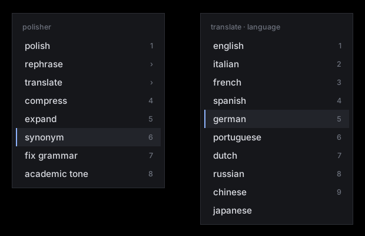
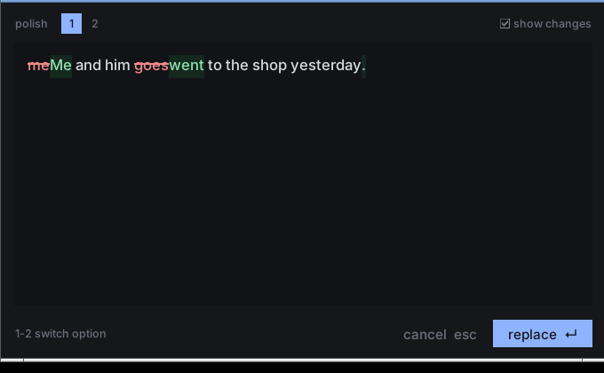

# polisher

Select text in **any app** (Word, Overleaf, a browser, a chat, a text editor), press a hotkey, and an LLM
polishes, rephrases, translates, compresses or expands it. The result replaces your selection.



## Hotkeys

The defaults are the same on Windows, Linux and macOS.

| Hotkey | What it does |
| --- | --- |
| `Ctrl+Alt+P` | **Quick polish.** One result, pasted straight over your selection. No questions asked. |
| `Ctrl+Alt+M` | **Menu.** A small popup with every mode; you get several options and a diff preview. |
| your app's undo | `Ctrl+Z` (`Cmd+Z` on macOS) undoes a replacement. It is a single paste, so one undo brings your text back. |

Why not `Ctrl+P`? It means *Print* in almost every app (and "previous line" on macOS). You can still use it:
set `polish = "ctrl+p"` under `[hotkeys]`. On Windows the key is swallowed, so Print won't open; on Linux and macOS it will.

## Modes

| Mode | |
| --- | --- |
| polish | Grammar, spelling, clarity. Minimal changes. |
| rephrase › tone | neutral, formal, casual, friendly, confident, persuasive, empathetic, academic |
| translate › language | english, italian, french, spanish, german, portuguese, dutch, russian, chinese, japanese |
| compress | Same ideas, fewer words |
| expand | Longer: adds detail, an explanation or an example that fits |
| synonym | Five replacement words for the selection |
| fix grammar | Grammar and spelling only, nothing else |
| academic tone | Formal scientific register |

Modes marked `›` open a second step. In any menu: arrows + `Enter`, `Esc`, `1`-`9`, or **just type to filter**.
In the language/tone step, anything you type that isn't in the list can be used too (`use "swedish"`).
The menu remembers your last tone/language per mode while Polisher runs.



The menu hotkey then shows a **diff preview**: red is removed, green is added, `1`-`3` switch between options,
`Enter` replaces, `Esc` cancels. Heavy rewrites and translations open in a clean view instead of a diff.

The popup appears at the **mouse pointer** (the text caret position isn't available across apps).

## More features

- **LaTeX-aware**: commands, `$math$`, environments, `\cite{}`, `\ref{}` and `%` comments are hidden from the model and restored afterwards. If the model damages one, that suggestion is discarded.
- **Bring your own model**: Anthropic, any OpenAI-compatible API (OpenAI, OpenRouter, LM Studio, vLLM...) or **Ollama** for fully local use.
- **Per-app profiles**: a different provider, mode or preview setting depending on the window (e.g. Overleaf).
- **History**: every original/result pair is stored locally; restore any original from the command line.
- **Shareable presets**: drop a `.toml` of modes and profiles into a folder or install it from a URL.

## Install

Requires Python 3.11+.

```bash
pipx install git+https://github.com/YOUR_USER/polisher
# or, from a clone:  pip install -e .
```

- **Linux**: `sudo apt install python3-tk xclip xdotool`, and use an X11 session (Wayland restricts global hotkeys).
- **macOS**: allow your terminal under *System Settings > Privacy & Security* for **Accessibility** and **Input Monitoring**, and allow it to control *System Events* when asked.
- **Windows**: nothing extra.

## Quick start

```bash
export OPENROUTER_API_KEY=sk-or-...  # free models via OpenRouter
# Or use Ollama locally (no API key), see below
polisher doctor                      # checks clipboard, hotkeys, key, config
polisher test "me and him goes to the shop yesterday"    # try the LLM without the GUI
polisher test "ciao a tutti" --mode translate --choice english
polisher                             # start it and leave it running
```

Then select text anywhere and press `Ctrl+Alt+P`.


### Free options (no Anthropic API required)

**Recommended: OpenRouter free models.** Create an API key at [OpenRouter](https://openrouter.ai/keys), then set `OPENROUTER_API_KEY` in your environment (or put it in `config.toml` as `api_key`, which is less secure). The default config uses `model = "openrouter/free"`, which automatically routes to an available free model. Free models are rate-limited and availability/model quality can vary. The app uses OpenRouter's OpenAI-compatible API, so no code changes are needed to switch models.

**Fully local alternative: Ollama.** Install [Ollama](https://ollama.com), download a model (e.g. `ollama pull llama3.1`), and set `provider = "ollama"`. This has no API fees, keeps selected text on your machine, and works offline after the model is downloaded; performance depends on your hardware.

For OpenRouter, free-tier limits and model availability can change. Do not send sensitive text to hosted providers unless you are comfortable with their data policies.

## Configuration

`polisher init` writes a commented `config.toml` (`polisher config-path` shows where). Examples:

```toml
[general]
provider = "openrouter"        # openrouter | ollama | anthropic | openai
quick_suggestions = 1          # quick hotkey: how many results (1 = replace immediately)
quick_preview = false          # set true to see the diff for the quick hotkey too
suggestions = 3                # menu hotkey: how many options
preview = true

[hotkeys]
polish = "ctrl+alt+p"
menu = "ctrl+alt+m"

# your own languages and tones (you can also type any other one in the menu)
[modes.translate]
choices = ["english", "italian", "french", "swedish"]
default_choice = "italian"     # used when a hotkey runs this mode without the menu

[modes.rephrase]
choices = ["neutral", "formal", "casual", "playful"]

# a dedicated one-key mode
[modes.to_italian]
label = "to italian"
prompt = "Translate the text into Italian. Output only the translation."
hotkey = "ctrl+alt+i"
suggestions = 1

# per-app settings: first matching profile wins
[[profiles]]
name = "Overleaf"
match_title = "Overleaf"
default_mode = "academic"
quick_preview = true
latex_aware = "always"
```

A mode is just a prompt. To give a mode choices, put `{choice}` in the prompt and list them in `choices`.
Overleaf and `.tex` windows already default to `latex_aware = "always"`.

### Presets

```bash
polisher presets add presets/email.toml
polisher presets add https://raw.githubusercontent.com/someone/repo/main/my-preset.toml
polisher presets list
polisher modes
```

Presets can only contain modes and profiles, never providers, keys or URLs, so installing one cannot redirect your text elsewhere.

## Commands

| Command | |
| --- | --- |
| `polisher` / `polisher run` | Start the background app |
| `polisher test "text" --mode rephrase --choice formal` | Run a mode from the terminal |
| `polisher modes` | List modes and their choices |
| `polisher history` / `--restore ID` / `--clear` | Browse history, copy an original back to the clipboard |
| `polisher presets add/list` | Manage presets |
| `polisher doctor` | Diagnose your setup |

## How it works

On a hotkey, polisher presses Copy, reads the clipboard, asks the model, then presses Paste and restores your previous
clipboard text. That is why it works in every app, and why it only handles text (an image on the clipboard is not restored).

## What has been tested

| | |
| --- | --- |
| Logic (LaTeX protection, prompts, providers, config, presets, profiles, history, hotkey matching) | 53 unit tests pass on Linux; a GitHub Actions workflow is included to run them on all three OSes |
| **Linux / X11**: hotkey-less end-to-end run with a fake LLM: copy, menu, submenu, typing a custom language, diff preview, paste, cancel | verified |
| **Windows**: key swallowing, bringing the popup to the foreground | written from the documentation, **not run yet** |
| **macOS**: matching `Ctrl+Alt+P` by physical key, focusing the popup, returning to your app before pasting | written from the documentation, **not run yet** |

If the popup doesn't react to the keyboard on Windows or macOS, the mouse still works, and every mode can be given its own hotkey (see above) so you can skip the menu.
Please open an issue with your OS version and what happened.

## Privacy

The selected text is sent to the provider you configure. Use `provider = "ollama"` to keep everything on your machine.
History is a local SQLite file; set `history = false` to disable it. API keys are read from environment variables by default.

## Development

```bash
pip install -e ".[dev]"
pytest
# GUI end-to-end test on Linux (virtual display + window manager + fake editor and LLM):
sudo apt install xvfb openbox xdotool xclip python3-tk
xvfb-run -a bash -c "openbox & sleep 1.5; python tests/manual/smoke_x11.py"
```

## Roadmap

Browser extension (true right-click menu), macOS Services entry, Android text-selection action, tray icon,
packaged installers (PyInstaller / MSI / dmg).

## License

MIT
